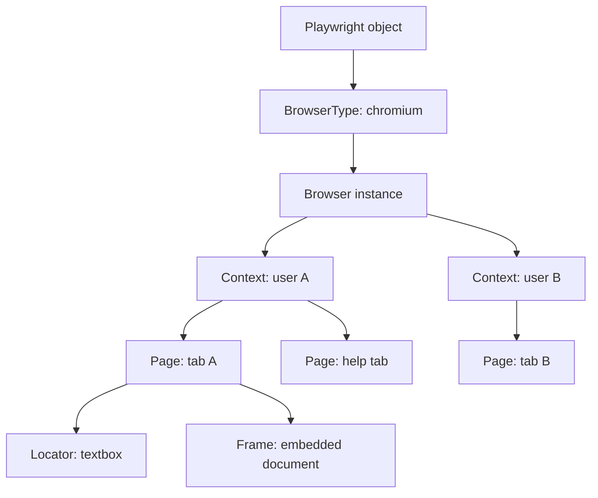

# Playwright Basics — Python

A beginner's guide to the driver, browser, context, page, locator, actions, and assertions. Examples use Chromium, matching your public-website example bundle.

## 1. What is Playwright?

Playwright lets a program operate a browser: open a website, type into fields, click buttons, and check the result. It supports UI testing and other browser automation.

For example, a program can open a todo website, enter “Learn Playwright”, press Enter, and verify that the item appears.

Two parts are involved: **doing something** (an action) and **checking the outcome** (an assertion). Clicking successfully does not by itself prove that the application produced the correct result.

## 2. The main objects at a glance

| Term | Simple meaning | Python example |
|---|---|---|
| Playwright driver | Background automation machinery connecting the Python API to the browser | Started by sync_playwright() / async_playwright() |
| Playwright object | Entry point for selecting browser types and other APIs | p |
| BrowserType | Factory for launching or connecting to a browser engine | p.chromium |
| Browser | A launched browser instance | browser = p.chromium.launch() |
| BrowserContext | An isolated browser session with its own cookies and storage | context = browser.new_context() |
| Page | One tab or popup in a context | page = context.new_page() |
| Frame | A document inside a page; includes its main frame and iframe documents | page.frame_locator(...) |
| Locator | A reusable description of how to find element(s) | page.get_by_role("button", name="Save") |
| Action | An operation on the page or an element | locator.click() |
| Assertion | A check of the expected state | expect(locator).to_be_visible() |

### Object relationships



The diagram shows object relationships, not operating-system process counts. A browser can internally use many processes.

## 3. What is the driver?

In Python, Playwright uses a bundled driver running separately from your Python code. Your API calls travel through this machinery to control the browser.

For example:

```python
page.get_by_role("button", name="Save").click()
```

Conceptually, your Python program asks Playwright to find the matching button, wait for it to be actionable, and click it in the browser.

You normally do not create a `driver` variable. In Selenium, you may have used `driver = webdriver.Chrome()`. In Playwright, the responsibilities are represented by several objects: `browser`, `context`, and `page`. Most everyday interaction happens through `page` and locators.

```python
with sync_playwright() as p:
    ...
```

Entering this block starts Playwright's machinery and gives you the Playwright entry object as `p`. Leaving the block stops that machinery. The name `p` is just a variable name; `playwright` would also work.

## 4. BrowserType and Browser

```python
browser = p.chromium.launch(headless=False)
```

- `p.chromium` is the browser type, a factory rather than an already-open browser.
- `launch()` starts a browser instance and returns a Browser object.
- `headless=False` displays browser windows.
- `headless=True` runs without visible windows. The default is headless.

Chromium is the open-source browser project underlying Chrome. Playwright's bundled Chromium is a separate installation from your ordinary Google Chrome.

To select an installed Google Chrome instead:

```python
browser = p.chromium.launch(channel="chrome", headless=False)
```

The Chrome channel requires Chrome to be installed. Our previous bundle's validation used bundled Chromium, not installed Chrome.

## 5. BrowserContext: an isolated session

```python
context = browser.new_context()
```

A context is like an isolated browser profile created for automation. It separates cookies and browser storage from other contexts. Creating a context does not create another full browser instance.

Think of two users testing the same site:

```python
alice = browser.new_context()
bob = browser.new_context()

alice_page = alice.new_page()
bob_page = bob.new_page()
```

Alice's login cookie is not automatically available to Bob. Two contexts are useful for testing separate users without logging one user out to log another in.

By contrast, pages in the same context generally share cookies and same-origin localStorage. Browser storage still obeys normal origin rules. sessionStorage is normally associated with an individual tab; do not assume all tabs share it.

Browser isolation does not isolate the website's database. If two contexts edit the same server-side account, they can still affect each other's application data.

You can also configure a context:

```python
context = browser.new_context(
    viewport={"width": 1280, "height": 720},
    locale="en-IN",
)
```

A viewport controls the page's rendering area, not necessarily the outer desktop window size.

## 6. Page: the browser tab

```python
page = context.new_page()
page.goto("https://demo.playwright.dev/todomvc/")
```

`Page` represents a tab or popup. It lets you navigate, create locators, interact with the keyboard and mouse, and inspect page information.

| Operation | Example |
|---|---|
| Open a URL | page.goto(url) |
| Read browser title | page.title() |
| Read current URL | page.url |
| Reload | page.reload() |
| Go back | page.go_back() |
| Close tab | page.close() |

`page.title()` is a method; `page.url` is a property, so it has no parentheses.

For teaching the object hierarchy, prefer explicit `browser.new_context()` followed by `context.new_page()`. The convenience method `browser.new_page()` creates a new context and page together; it does not mean every page always needs a separate context.

## 7. DOM and elements

The browser parses HTML into a document object model (DOM). The DOM contains elements such as inputs, buttons, links, and headings.

For illustration, imagine a website contains:

```html
<label for="username">Username</label>
<input id="username" placeholder="Enter username">
<button>Sign in</button>
```

Playwright can locate the input by its associated label and locate the button by role and accessible name:

```python
page.get_by_label("Username", exact=True).fill("tester")
page.get_by_role("button", name="Sign in", exact=True).click()
```

This illustrative login snippet requires a site with that HTML; it is not the TodoMVC page used in the complete examples below.

## 8. Locator: how to find something

```python
entry = page.get_by_placeholder("What needs to be done?")
```

This creates a locator describing the textbox. It does not type anything and does not freeze a particular DOM element in memory. Playwright resolves the matching element when an operation needs it, which helps when a framework re-renders the page.

```python
entry.fill("Learn Playwright")
entry.press("Enter")
```

The locator describes **where**; `fill` and `press` describe **what to do**.

### Common locator choices

| Locator | What it uses | Example |
|---|---|---|
| get_by_role | Accessibility role and optionally accessible name | page.get_by_role("button", name="Submit") |
| get_by_label | Label associated with a form control | page.get_by_label("Username") |
| get_by_placeholder | Input placeholder | page.get_by_placeholder("Search") |
| get_by_text | Element text content | page.get_by_text("Welcome") |
| get_by_alt_text | Alternative text, often on an image | page.get_by_alt_text("Company logo") |
| get_by_title | HTML title attribute | page.get_by_title("Save changes") |
| get_by_test_id | Test ID; data-testid by default | page.get_by_test_id("todo-title") |
| locator | CSS selector or explicit XPath | page.locator("#username") |

Prefer roles, labels, and stable test IDs where appropriate. A role is the element's semantic purpose. An accessible name may come from visible text, a label, or accessibility attributes; it is not simply the HTML `name` attribute.

### CSS and XPath illustrations

```python
page.locator("#username")                  # id="username"
page.locator(".product-card")             # class="product-card"
page.locator('input[name="email"]')        # HTML name attribute
page.locator('xpath=//button[text()="Save"]')
```

These are syntax examples; matching HTML must exist on the page you open.

### Multiple matches and scoping

A locator may match multiple elements. An operation such as clicking a single button normally requires one match. Multiple matches can cause a strict-mode error.

Use a narrower locator:

```python
item = page.get_by_test_id("todo-item").filter(has_text="Read a tutorial")
item.get_by_role("checkbox").check()
```

This finds the checkbox within the relevant todo row. Use `.first` or `.nth(0)` only when position is intentionally part of the test's meaning; selecting the first match can otherwise hide an ambiguous locator.

## 9. Actions

| Action | Use |
|---|---|
| fill("text") | Replace editable content with text |
| click() | Click an element |
| dblclick() | Double-click |
| press("Enter") | Send a keyboard key |
| check() | Ensure a checkbox is checked |
| uncheck() | Ensure a checkbox is unchecked |
| select_option(label="Two") | Choose an option in a native select |
| hover() | Move the pointer over an element |
| set_input_files("report.csv") | Set a file input's selected file |

For checkboxes, `check()` expresses the required state clearly. A click merely toggles the current state, which can make a test dependent on how it started.

## 10. Assertions: did the application behave correctly?

```python
from playwright.sync_api import expect

expect(page).to_have_title("React • TodoMVC")
expect(page.get_by_test_id("todo-title")).to_have_text("Learn Playwright")
expect(page.get_by_test_id("todo-item")).to_have_count(1)
```

Playwright's supported `expect` assertions retry while waiting for the expected state, up to their timeout. A successful action and a successful assertion answer different questions: did the click occur, and did the expected result appear?

A normal Python assertion does not provide that retry behavior:

```python
assert page.title() == "React • TodoMVC"
```

This checks the title returned at that moment. For browser states that may update asynchronously, prefer Playwright's retrying assertions.

## 11. Auto-waiting and timeouts

For actions such as clicking, Playwright checks relevant conditions such as whether the element is visible, stable, enabled, and able to receive events. The exact checks depend on the action. If they do not pass in time, the action fails.

Auto-waiting does not prove that every background request has finished or that the business workflow succeeded. Assert the specific result you care about.

```python
page.set_default_timeout(15000)             # Actions: 15 seconds.
page.set_default_navigation_timeout(45000)  # Navigation: 45 seconds.
expect.set_options(timeout=10000)          # Assertions: 10 seconds.
```

Timeouts are maximum waiting periods, not compulsory delays. Assertion timeouts are configured separately from action timeouts.

Avoid fixed sleeps as a normal synchronization strategy. A `slow_mo` launch option can help learners see actions, but slowing actions is not a correctness check.

## 12. Complete synchronous example

Save the following as `basics_sync.py`. It opens a real public demo, adds a todo, verifies it, and cleans up.

```python
from playwright.sync_api import sync_playwright, expect


def main():
    with sync_playwright() as p:
        browser = p.chromium.launch(headless=False)
        try:
            context = browser.new_context()
            try:
                page = context.new_page()
                page.goto("https://demo.playwright.dev/todomvc/")

                entry = page.get_by_placeholder("What needs to be done?")
                entry.fill("Learn Playwright")
                entry.press("Enter")

                expect(page.get_by_test_id("todo-title")).to_have_text(
                    "Learn Playwright"
                )
                print("PASS: todo was added")
            finally:
                context.close()
        finally:
            browser.close()


if __name__ == "__main__":
    main()
```

Read the code in this order: start Playwright, launch browser, create context, create tab, navigate, locate, act, assert, close resources.

## 13. Complete asynchronous example

Save as `basics_async.py`.

```python
import asyncio
from playwright.async_api import async_playwright, expect


async def main():
    async with async_playwright() as p:
        browser = await p.chromium.launch(headless=False)
        try:
            context = await browser.new_context()
            try:
                page = await context.new_page()
                await page.goto("https://demo.playwright.dev/todomvc/")

                entry = page.get_by_placeholder("What needs to be done?")
                await entry.fill("Learn Playwright")
                await entry.press("Enter")

                await expect(page.get_by_test_id("todo-title")).to_have_text(
                    "Learn Playwright"
                )
                print("PASS: todo was added")
            finally:
                await context.close()
        finally:
            await browser.close()


if __name__ == "__main__":
    asyncio.run(main())
```

`async def` defines an asynchronous function. `asyncio.run()` runs its coroutine using an event loop. `await` waits for an asynchronous operation while allowing other ready tasks to execute.

This script still performs its dependent actions sequentially. Using async does not automatically run several tests concurrently.

| Operation | Sync | Async |
|---|---|---|
| Start API | with sync_playwright() as p | async with async_playwright() as p |
| Launch browser | p.chromium.launch() | await p.chromium.launch() |
| Create context | browser.new_context() | await browser.new_context() |
| Create page | context.new_page() | await context.new_page() |
| Create locator | page.get_by_role(...) | page.get_by_role(...) |
| Click | locator.click() | await locator.click() |
| Read title | page.title() | await page.title() |
| Read URL | page.url | page.url |
| Assert text | expect(locator).to_have_text(...) | await expect(locator).to_have_text(...) |
| Set timeout | page.set_default_timeout(...) | page.set_default_timeout(...) |
| Close browser | browser.close() | await browser.close() |

Constructing a locator does not need `await`. Do not mix objects imported from sync_api and async_api within one workflow.

## 14. Installation and running

Use a virtual environment. From the directory containing your scripts:

```bash
python3 -m venv .venv
source .venv/bin/activate
python -m pip install playwright
python -m playwright install chromium
python basics_sync.py
python basics_async.py
```

On Windows Command Prompt, use `py -m venv .venv` and `.venv\Scripts\activate` for the first two steps. Run these standalone examples from a terminal; notebooks already running an event loop need a different async entry point.

Your existing `03_playwright_public_simple` bundle pins its validated Playwright version in requirements.txt. To use that environment, activate it and run `python -m pip install -r requirements.txt` from the bundle directory.

## 15. Multiple tabs and frames

Two tabs in one context:

```python
page_one = context.new_page()
page_two = context.new_page()
```

When an action opens a popup, register the event listener before clicking:

```python
with page.expect_popup() as popup_info:
    page.get_by_role("link", name="Open help", exact=True).click()
help_page = popup_info.value
```

This illustrative snippet needs a site whose Open help link opens another tab. It is not an instruction to run against TodoMVC.

An iframe is an embedded document inside a page:

```python
support = page.frame_locator('iframe[title="Support frame"]')
support.get_by_role("button", name="Send", exact=True).click()
```

This also assumes matching HTML. A normal page locator does not automatically search inside iframe documents. A FrameLocator describes how to enter the frame and locate elements there; it is not another browser tab.

## 16. Cleanup and lifecycle

| Operation | Effect |
|---|---|
| page.close() | Close one tab |
| context.close() | Close that context and its pages |
| browser.close() | Close the launched browser and its pages |
| Exit Playwright context manager | Stop the driver machinery |

Use `try/finally` so cleanup runs when an assertion raises. Explicitly closing a context before the browser is also useful when saving artifacts such as recordings or traces.

Fresh contexts are non-persistent by default. Their storage is not automatically reused in the next run. For deliberate reuse, Playwright can save and load storage state. Such files may contain authentication secrets.

## 17. Where pytest fits

Playwright performs browser automation. Pytest discovers and runs tests, supplies fixtures through plugins, and reports results. They are different tools that can work together.

With pytest-playwright installed, this test requests a `page` fixture:

```python
from playwright.sync_api import expect


def test_heading(page):
    page.goto("https://demo.playwright.dev/todomvc/")
    expect(page.get_by_role("heading", name="todos", exact=True)).to_be_visible()
```

```bash
python -m pip install pytest-playwright
python -m pytest test_example.py --browser chromium --headed -v
```

The plugin creates and cleans up the page/context. A custom conftest.py can add fixtures such as `lab_url`, `lab`, and `logged_in_page` from your earlier module.

Standalone scripts create their own objects explicitly. Pytest examples receive objects through fixtures. The browser concepts remain the same. Async pytest integration requires suitable async fixtures/plugins; the standalone async example above needs only Playwright and asyncio.

## 18. Common beginner mistakes

| Mistake | Better approach |
|---|---|
| Calling the browser object a page | Keep browser, context, and page roles distinct |
| Thinking every context launches a browser | Multiple isolated contexts can share one browser instance |
| Thinking a locator is an already-captured HTML element | It describes how to locate matching elements when used |
| Clicking a locator that matches several buttons | Scope it by role, name, row, or another stable attribute |
| Treating click success as test success | Assert the expected outcome |
| Adding sleeps after every action | Use locators, auto-waiting, and retrying assertions |
| Forgetting await for an async action | Await actions, assertions, and async creation/cleanup methods |
| Adding await to locator creation | Construct the locator normally |
| Assuming isolation creates a clean database | Reset application data separately if required |
| Expecting the website to stay open forever | The script closes it when its work is complete |

## 19. Connect this guide to your example bundle

Open `03_playwright_public_simple/sync/02_add_todo.py` and its matching async file.

| Code in that bundle | Concept |
|---|---|
| sync_playwright / async_playwright | Playwright startup |
| p.chromium.launch(...) | Browser type launching a Browser |
| browser.new_context() | Isolated session |
| context.new_page() | Tab |
| page.goto(URL, ...) | Navigation |
| page.get_by_placeholder(...) | Locator |
| entry.fill(...) / entry.press(...) | Actions |
| expect(...).to_have_text(...) | Assertion |
| finally: browser.close() | Cleanup |

The previous bundle's 20 scripts passed live checks on 20 November 2026, as recorded in its VALIDATION.md. That historical result is not a fresh execution of every snippet in this guide. Code fragments outside the two complete examples illustrate individual concepts and may require the described HTML.

## 20. Official references

The concepts were checked against official documentation on 21 November 2026:

- [Python sync and async usage](https://playwright.dev/python/docs/library)
- [Browser types](https://playwright.dev/python/docs/api/class-browsertype)
- [Browser contexts and isolation](https://playwright.dev/python/docs/browser-contexts)
- [Pages](https://playwright.dev/python/docs/pages)
- [Locators](https://playwright.dev/python/docs/locators)
- [Auto-waiting](https://playwright.dev/python/docs/actionability)
- [Assertions](https://playwright.dev/python/docs/test-assertions)
- [Pytest integration](https://playwright.dev/python/docs/test-runners)
